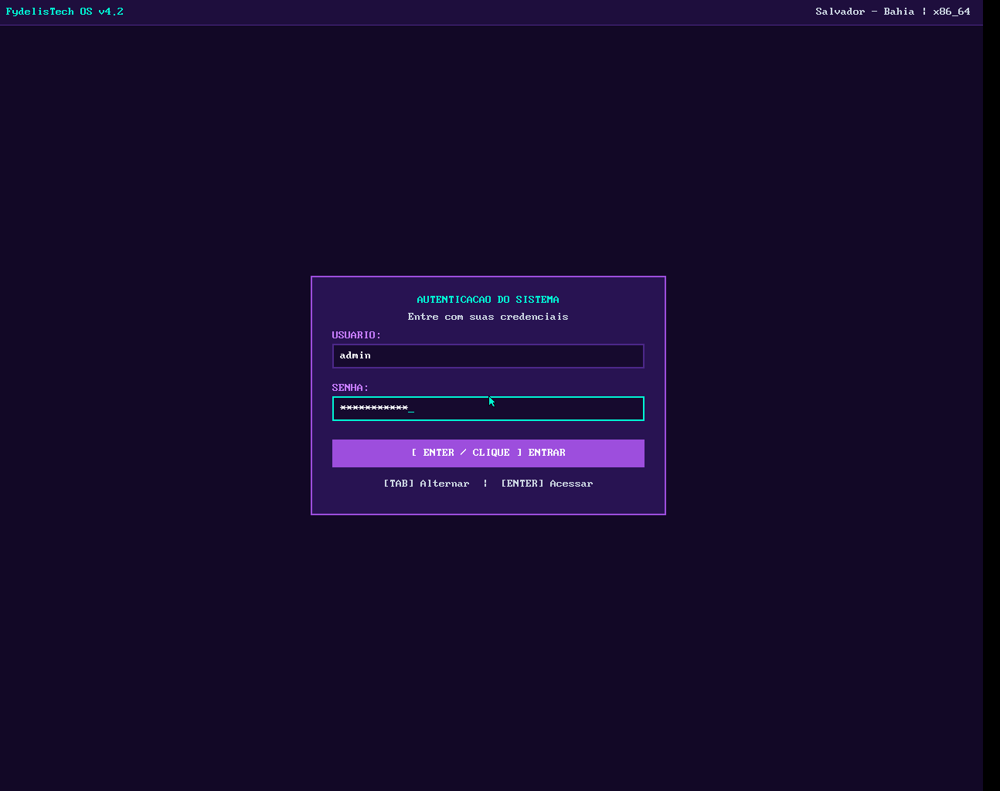
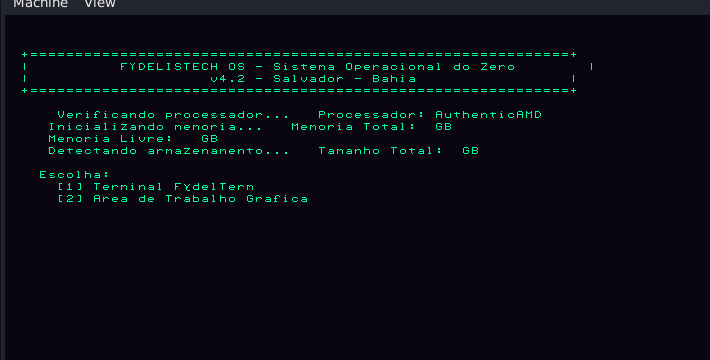
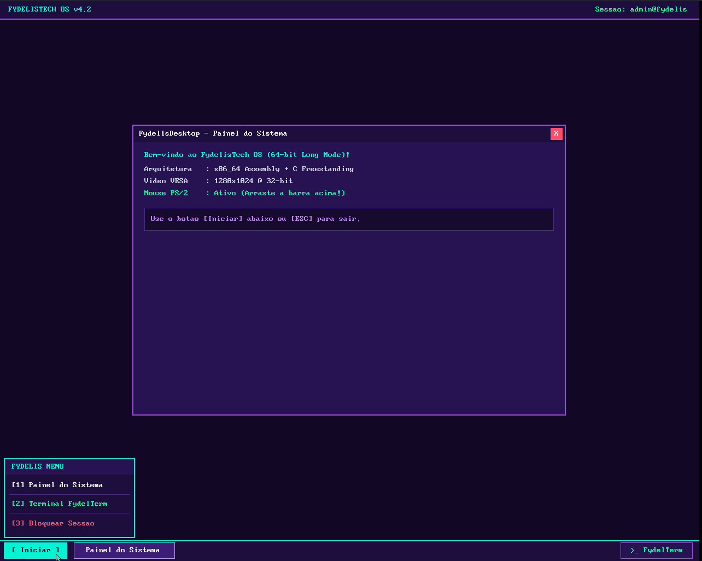

# 🚀 FydelisTech OS v4.2

> **Sistema Operacional 64-bit desenvolvido do ZERO em Assembly & C**
> 📍 Salvador – Bahia | x86_64 Long Mode | Sem dependências externas

---

<div align="center">

**[Sobre o Projeto]** • **[Funcionalidades]** • **[Capturas de Tela]** • **[Compilação]** • **[Estrutura]** • **[Contribuição]**

</div>

---

## 📌 Sobre o Projeto

O **FydelisTech OS** é um sistema operacional independente (*freestanding*) de 64 bits (x86_64 — Long Mode), construído inteiramente do zero sem uso de bibliotecas padrão como a `libc` ou camadas de sistemas hospedeiros.

Na versão **v4.2**, o sistema abandonou o modo texto VGA legado e passou a operar integralmente em **modo gráfico de alta resolução** através do **VESA Linear Framebuffer 32-bit (XRGB8888)**, combinando drivers de hardware escritos em NASM Assembly com um motor gráfico e gerenciador de desktop desenvolvido em C.

---

## 🖼️ Capturas de Tela

### 🔐 Tela de Login


> Tela de autenticação gráfica com suporte a teclado (`[TAB]` para alternar, `[ENTER]` para confirmar) e clique do mouse.

### 🖥️ Terminal FydelTerm


> Shell interativo em modo gráfico com comandos do sistema, diagnósticos de hardware e módulos de segurança/rede.

### 🪟 Área de Trabalho Gráfica


> Desktop funcional com barra de tarefas, Menu Iniciar, janelas arrastáveis e suporte a mouse PS/2.

---

## ✨ Principais Funcionalidades

### 🧠 Kernel 64-bit Long Mode
- ✅ Bootloader próprio de 512 bytes
- ✅ Configuração de GDT, IDT e tratamento de interrupções
- ✅ Paginação e gerenciamento de memória física e heap
- ✅ Detecção de CPU (`CPUID`), memória RAM e armazenamento

### 🎨 Sistema Gráfico
- ✅ Renderização direta no **VESA Linear Framebuffer 32-bit**
- ✅ Fontes bitmap próprias (8×8 e 8×16 ASCII completa)
- ✅ Decodificador **UTF-8** integrado no terminal
- ✅ Compositor de janelas com suporte a arrastar e fechar

### 🖱️ Drivers de Hardware
| Driver | Status | Detalhe |
|---|---|---|
| **Mouse PS/2** | ✅ Operacional | Máquina de estado de 3 bytes, cursor gráfico sem rastro |
| **Teclado PS/2** | ✅ Operacional | Leitura via scancodes isolados |
| **Vídeo VESA** | ✅ Operacional | Framebuffer linear 32-bit XRGB8888 |
| **PCI / GPU** | ✅ Detecção | Suporte a Intel, AMD, VirtIO e UEFI GOP |
| **Armazenamento** | 🔄 Em desenvolvimento | Detecção de discos e partições |
| **Rede** | 🔄 Em desenvolvimento | Módulo de rede e segurança |

### 🖥️ Ambientes do Sistema
- **[1] Terminal FydelTerm** — Shell interativo com comandos, editor e diagnósticos
- **[2] Área de Trabalho Gráfica** — Interface gráfica completa com janelas e menus

---

## 🗂️ Estrutura do Repositório

FydelisTechOS-V2/
├── boot/          # Bootloader, GDT, IDT, interrupções e linker script
├── kernel/        # Núcleo 64-bit (kernel.asm), motor gráfico C (exec.c) e Makefile
├── drivers/       # Drivers: teclado, mouse, vídeo, PCI, disco e rede
├── grafico/       # Compositor de janelas, framebuffer e GPU dispatch
├── idioma/        # Suporte a múltiplos idiomas
├── include/       # Cabeçalhos compartilhados (.h)
├── pentest/       # Módulos de segurança e pentest 🛡️
├── system/        # Configurações, logs e stubs do sistema
├── user/          # Espaço de usuário e chamadas de sistema
├── virtual/       # Detecção e suporte a virtualização (VMX / SVM / EPT)
├── Desktop.png    # Screenshot da área de trabalho
├── FyelTerm.png   # Screenshot do terminal
├── Login.png      # Screenshot da tela de login
├── versoes.json   # Histórico de versões
├── LICENSE.md     # Licença GPL v3.0
└── README.md      # Este arquivo!


---

## 🚀 Como Compilar e Executar

### 📋 Pré-requisitos
> Ambiente recomendado: **Linux — Debian / Ubuntu**

```bash
sudo apt update
sudo apt install build-essential nasm gcc ld qemu-system-x86 genisoimage

cd kernel
make clean && make
